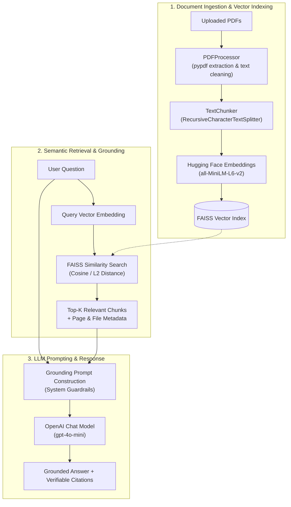

# DocuLens AI 🔍
### Intelligent PDF Question Answering System using RAG & LLMs

[](https://www.python.org/)
[](https://streamlit.io/)
[](https://www.langchain.com/)
[](https://github.com/facebookresearch/faiss)
[](https://huggingface.co/sentence-transformers/all-MiniLM-L6-v2)
[](https://opensource.org/licenses/MIT)

---

## 1. Project Overview

**DocuLens AI** is an enterprise-grade, retrieval-augmented document intelligence web application designed to allow users to ingest multiple PDF documents, ask complex questions, and receive accurate, hallucination-resistant answers with exact page citations and supporting excerpts.

Built with **Python**, **Streamlit**, **LangChain**, **Hugging Face Sentence Transformers**, **FAISS**, and **OpenAI GPT-4o-mini**, the application bridges private document repositories with generative AI while maintaining absolute data privacy and factual grounding.

---

## 2. Problem Statement

Large Language Models (LLMs) are powerful general-purpose reasoning engines, but they suffer from two critical flaws when applied to specialized documents:
1. **Hallucination:** LLMs often fabricate convincing yet false facts when lacking specific domain context.
2. **Context Window Limitations & Cost:** Passing entire 50-page or 100-page PDF documents directly to an LLM context window causes high latency, token truncation, and prohibitive per-query API expenses.

**DocuLens AI** addresses these problems through **Retrieval-Augmented Generation (RAG)**: instead of feeding whole PDFs to the model, it creates dense vector embeddings for semantic chunks, performs high-speed sub-millisecond similarity search using FAISS, and passes only the most relevant passages to the LLM with strict grounding constraints.

---

## 3. Key Features

- 📑 **Multi-PDF Ingestion & Processing:** Upload single or multiple PDF documents with automatic validation, empty file detection, and corrupted file handling.
- 🧹 **Robust Text Cleaning & Preprocessing:** Sanitizes raw text, removes non-printable characters, normalizes line breaks, and strips whitespace artifacts.
- 🧩 **Hierarchical Semantic Chunking:** Splits document text using `RecursiveCharacterTextSplitter` with configurable chunk sizes and overlap, preserving document metadata and page tracking.
- ⚡ **Local Dense Embeddings:** Employs Hugging Face's `all-MiniLM-L6-v2` locally on CPU. Vectors are generated offline with **zero API token costs**.
- 🗄️ **High-Performance FAISS Vector Database:** Stores high-dimensional dense vectors and supports sub-millisecond similarity search and incremental document additions.
- 🎯 **Hallucination-Resistant RAG Synthesis:** Enforces strict system prompt guardrails that compel the LLM to answer *only* from retrieved context and clearly state when information is unavailable.
- 📚 **Verifiable Source Attribution:** Every response includes expandable citations displaying the source PDF filename, page number, similarity score, and exact excerpt.
- 💬 **Stateful Conversational Memory:** Maintains session chat history, allows continuous interactive dialogue, and provides one-click conversation reset.
- 🎨 **Modern SaaS Dashboard UI:** Designed with a clean aesthetic featuring rounded cards, status badges, metrics displays, and responsive layout.

---

## 4. System Architecture



---

## 5. Technology Stack

| Layer | Technology | Purpose |
| :--- | :--- | :--- |
| **Language** | Python 3.11 | Core programming language |
| **User Interface** | Streamlit | Responsive SaaS dashboard |
| **Orchestration** | LangChain Core & Community | RAG pipeline, prompt templates, splitters |
| **Embeddings** | Hugging Face `all-MiniLM-L6-v2` | 384-dimensional dense vectors computed locally |
| **Vector DB** | FAISS (Facebook AI Similarity Search) | High-speed indexing and nearest-neighbor search |
| **PDF Extraction** | PyPDF | Page-level text extraction and metadata tracking |
| **Data Processing**| Pandas & NumPy | Numerical operations and structured summaries |
| **Generative LLM** | OpenAI API (`gpt-4o-mini`) | Context-grounded synthesis |
| **Configuration** | python-dotenv | Secure environment variable management |
| **Testing** | PyTest | Automated unit and integration testing suite |

---

## 6. Project Directory Structure

```text
DocuLens AI/
│
├── app.py                      # Main Streamlit web application & UI
├── config.py                   # Centralized configuration & environment loader
├── requirements.txt            # Pinned, tested project dependencies
├── .env.example                # Template for environment variables
├── .gitignore                  # Excludes venv, .env, caches, and test artifacts
├── README.md                   # Comprehensive project documentation
│
├── src/                        # Modular source code package
│   ├── __init__.py             # Source package initializer
│   ├── pdf_processor.py        # PDF text extraction, cleaning, and validation
│   ├── text_chunker.py         # Text chunking and chunk statistics
│   ├── embeddings.py           # Hugging Face local embedding singleton
│   ├── vector_store.py         # FAISS vector store manager
│   ├── rag_pipeline.py         # End-to-end RAG orchestrator & citations
│   └── chat_manager.py         # Active session chat history & transcript export
│
├── assets/                     # Application assets and branding
│   └── .gitkeep
│
└── tests/                      # Automated test suite
    ├── __init__.py             # Test package initializer
    ├── test_pdf_processor.py   # Tests for extraction, cleaning, and validation
    ├── test_text_chunker.py    # Tests for chunking and metadata preservation
    ├── test_vector_store.py    # Tests for FAISS indexing and retrieval
    └── test_rag_pipeline.py    # Tests for RAG prompt construction and fallbacks
```

---

## 7. Installation & Setup (Windows)

### Step 1: Clone or Navigate to the Project Directory
```powershell
cd "c:\Users\frinu\OneDrive\Desktop\DocuLens AI"
```

### Step 2: Create & Activate Python 3.11 Virtual Environment
```powershell
# Create virtual environment named 'venv'
py -3.11 -m venv venv

# Activate virtual environment
.\venv\Scripts\Activate.ps1
```
*(If prompted by PowerShell security policy, run `Set-ExecutionPolicy -ExecutionPolicy RemoteSigned -Scope Process`)*

### Step 3: Install Required Dependencies
```powershell
pip install -r requirements.txt
```

---

## 8. Configuration

1. Copy `.env.example` to create your local `.env` file:
```powershell
Copy-Item .env.example .env
```

2. Open `.env` in any text editor and supply your OpenAI API key:
```env
OPENAI_API_KEY=sk-proj-your-actual-api-key-here
DEFAULT_LLM_MODEL=gpt-4o-mini
DEFAULT_EMBEDDING_MODEL=all-MiniLM-L6-v2
```

> **Note:** You can also enter or update your OpenAI API key directly inside the application's left sidebar at runtime!

---

## 9. Running the Application

Execute the following command in PowerShell with the virtual environment activated:

```powershell
streamlit run app.py
```

The Streamlit web server will start and automatically open your default browser at:
```text
http://localhost:8501
```

---

## 10. Automated Testing

Run the automated test suite using `pytest`:

```powershell
pytest -v
```

All unit tests verify:
- Accurate PDF extraction and corrupted file rejection.
- Text cleaning and whitespace normalization.
- Metadata preservation across document splitting.
- FAISS vector store indexing and nearest-neighbor search.
- Graceful fallbacks when API keys are unconfigured.

---

## 11. Security & Best Practices

- **Zero Hardcoded Secrets:** API keys are never stored in source code. They are loaded exclusively from `.env` or session memory.
- **Local Embedding Privacy:** Documents are embedded locally on your computer via Hugging Face. Raw document text is not uploaded to external embedding services.
- **Git Hygiene:** `.gitignore` excludes `.env`, `venv/`, FAISS index binaries, temporary caches, and uploaded PDF files.

---

## 12. Limitations & Future Enhancements

### Current Limitations:
- Scanned (image-only) PDFs require optical character recognition (OCR) before processing.
- Multi-column tables with complex non-linear layouts may benefit from specialized table extractors.

### Future Enhancements:
- [ ] Integration with OCR (Tesseract / EasyOCR) for scanned PDFs.
- [ ] Hybrid Search (BM25 Keyword Search + FAISS Dense Vectors via EnsembleRetriever).
- [ ] Support for tabular Q&A over CSV/Excel files.
- [ ] Multi-query expansion and HyDE (Hypothetical Document Embeddings) for advanced queries.

---

## 13. License

This project is licensed under the MIT License - feel free to adapt and use it for academic and professional portfolios.
